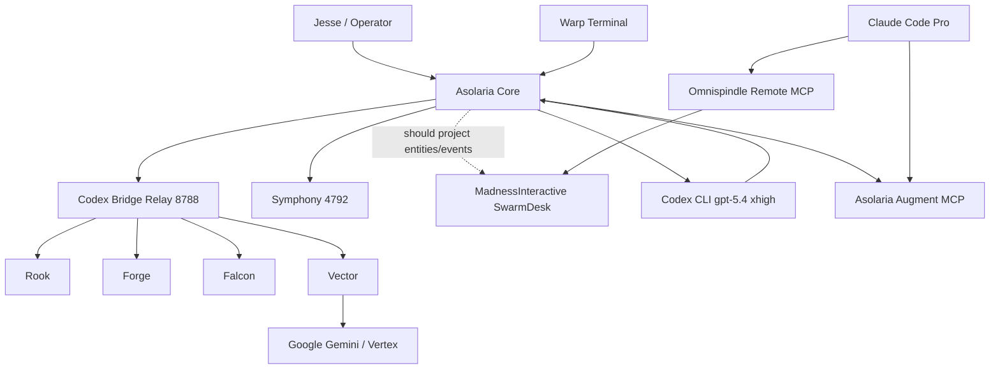

# Super Swarm Baseline

Updated: 2026-03-12

## Verified Live State

- Asolaria main control plane on `127.0.0.1:4781` had been crashing because a background semantic-index rebuild let a Gemini embedding TLS reset escape as a fatal rejection. That path is now guarded in `src/semanticKnowledgeStore.js`.
- Local relay is live at `127.0.0.1:8788`.
- Active bridge lanes: `asolaria`, `rook`, `forge`, `falcon`, `vector`, `watchdog`.
- Bridge tunnel exists but tunnel health is failing; local relay health is good.
- Symphony service is running on `127.0.0.1:4792`.
- Symphony tracking issue created: `ASO-10` / `Integrate Asolaria entity graph with MadnessInteractive SwarmDesk`.
- Codex CLI is configured for `gpt-5.4` with reasoning effort `xhigh`.
- Claude Code is authenticated on the paid `plasmatoid@gmail.com` account and has project MCP entries for:
  - `omnispindle` -> `https://madnessinteractive.cc/api/mcp/`
  - `asolaria-augment` -> `http://127.0.0.1:4793/mcp`
- The Asolaria augment bridge is healthy in `local_workspace_search` mode.
- SwarmDesk is live in the browser, but the visible left project rail is still static:
  - `Inventorium`
  - `Omnispindle`
  - `Swarmonomicon`
  - `SwarmDesk`
  - `DVT TestKit`
- SwarmDesk inspector evidence shows:
  - sidebar header is just `<h3> Projects</h3>`
  - `Current Project` is empty
  - `UML Source` is currently `Omnispindle`
- External dashboard observation from the live UI:
  - `Active Projects: 0`
  - `Agents Active: 4`
  - `System Load: 43%`
  - `Code City Stats`: all zero

## Agent Poll

These replies were collected through the live relay with sender-token enforcement.

- `rook`:
  - immediate blocker is local control-plane fragility on the 16 GB machine
  - safest topology is one brokered hub, not mesh coupling
  - first infra step is a shared attestation payload across Asolaria, SwarmDesk, and Omnispindle
- `forge`:
  - use one canonical `Entity + Edge` contract
  - missing surface is typed graph ingestion from existing identity/registry sources
  - first implementation step is a normalizer over `agents-registry.json` and related identity files
- `falcon`:
  - best operator surface is a persistent 3D overview plus timeline/detail panel
  - biggest risk is mixing navigation and command input in the same touch surface
  - first verification step is a single mobile command flow end to end
- `asolaria`:
  - north star is SwarmDesk as the canonical control-plane ledger
  - current mismatch is cross-surface trust/provenance not being written into one shared graph
  - first system fix is one shared entity/attestation schema
- `vector`:
  - failed twice with `fetch failed`
  - this lane is not healthy enough yet to be treated as a reliable Google/Gemini coworker

## Current Mismatch

The swarm is real, but the 3D world is not yet receiving the real swarm graph.

- Asolaria, Claude Code, Gemini, and the bridge lanes exist locally.
- SwarmDesk currently renders a static project list and an `Omnispindle`-sourced Code City.
- The analytics panel is showing agent activity without a populated Asolaria project/entity feed.
- The trusted coder surfaces are configured, but they are not yet emitted as first-class entities into SwarmDesk.

## Canonical Entity Model

Minimum schema to unify the ecosystem:

- `entity_id`
- `kind`
- `display_name`
- `profile_id`
- `surface_type`
- `controller`
- `trust_level`
- `runtime_status`
- `task_id`
- `delegated_by`
- `tool_action`
- `artifact_uri`
- `timestamp`

Minimum edge types:

- `CONTROLS`
- `ROUTES_TO`
- `USES`
- `TRUSTS`
- `OBSERVES`
- `REPORTS_TO`
- `PROJECTS_TO`

## Verified Network Sketch

## Initial Integration Program

1. Export a canonical entity graph snapshot from local verified sources.
2. Emit attestable execution events from Asolaria and bridge lanes.
3. Add a SwarmDesk ingestion surface for entities, edges, and activity events.
4. Feed `Asolaria` into project selection and set `Current Project` from live graph state.
5. Stop treating Code City as `Omnispindle`-only; support an `Asolaria` or merged source.
6. Repair the `vector` fetch path so Gemini becomes a reliable cloud worker instead of a nominal one.

## Immediate Truths

- The ecosystem is real enough to integrate now.
- The external 3D world is still mostly presentation without the Asolaria graph behind it.
- The correct next move is not more guessing; it is a graph/export layer that turns the verified local runtime into SwarmDesk entities.
